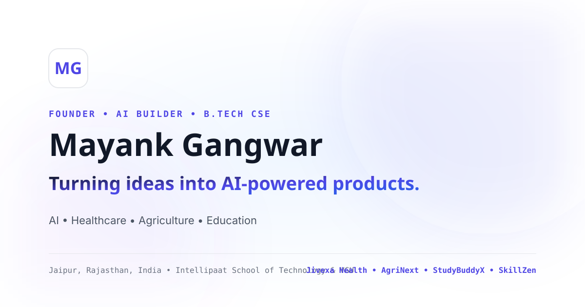

# Mayank Gangwar — Founder, AI Builder & Entrepreneur Portfolio

A premium, modern, responsive personal portfolio website for **Mayank Gangwar** — Founder, AI Builder & Entrepreneur. Built with a high-fidelity design combining the visual quality of Apple, the polish of Linear, and the ambient innovation of early-stage AI startups.



---

## 🌟 Personal Brand Identity

- **Name:** Mayank Gangwar
- **Titles:** Founder & CEO | AI Builder | Entrepreneur | B.Tech CSE Student
- **Location:** Jaipur, Rajasthan, India
- **Email:** [mayank.gangwar.hq@gmail.com](mailto:mayank.gangwar.hq@gmail.com)
- **GitHub:** [mayankgangwarhq](https://github.com/mayankgangwarhq)
- **LinkedIn:** [mayankgangwar-tech](https://www.linkedin.com/in/mayankgangwar-tech/)
- **Main Headline:** *"Building Ideas. Creating Impact."*
- **Subheadline:** *"I'm Mayank Gangwar — a student, founder, and technology enthusiast exploring AI, healthcare, agriculture, and education through real-world projects."*
- **Tagline:** *"Learn. Build. Experiment. Repeat."*
- **Founder Status:** `Currently Building | Early-Stage Projects`

---

## 🚀 Featured Projects & Prototypes

All four projects are structured in a single data store (`src/data/portfolioData.js`):

1. **Jivexa Health** (`HealthTech | AI | Digital Healthcare`)
   - **Tagline:** *"AI-Powered Health. Connected Care."*
   - **Status:** `Live Prototype / Testing`
   - **Live Link:** [https://jivexa-one.vercel.app/](https://jivexa-one.vercel.app/)
   - **Identity:** Emerald-green and teal healthcare aesthetic with official brand crest.
   - **Important Notice:** Explicitly framed as an informational clinical support tool, not a replacement for qualified medical professionals.

2. **AgriNext** (`AgriTech | Agriculture Technology`)
   - **Tagline:** *"Technology for the Agricultural Ecosystem."*
   - **Status:** `Live Prototype`
   - **Live Link:** [https://agrinextfrontend69.vercel.app/](https://agrinextfrontend69.vercel.app/)
   - **Identity:** Fresh green and teal agricultural technology aesthetic.

3. **StudyBuddy AI** (`AI | Education Technology`)
   - **Tagline:** *"AI-Assisted Learning & Academic Support."*
   - **Status:** `Live Application`
   - **Live Link:** [https://mayank-study-buddy-ai-c93aa7ff.base44.app](https://mayank-study-buddy-ai-c93aa7ff.base44.app)
   - **Identity:** Academic violet and electric blue AI learning platform.

4. **SkillZen** (`AI Education | Digital Skills`)
   - **Tagline:** *"Learn Today. Build Tomorrow."*
   - **Status:** `Early-Stage Project`
   - **Link:** *Details Coming Soon*
   - **Identity:** Minimal modern education brand with geometric SZ emblem.

---

## 🎨 Visual Design System — Premium White Editorial

- **Primary Background:** Pure White (`#FFFFFF`) — 75–85% of interface.
- **Alternate Section Background:** Crisp Light Slate (`#F8FAFC`).
- **Soft Blue Section Background:** Pale Blue (`#EFF6FF`).
- **Soft Lavender Highlight:** Pale Violet (`#F5F3FF`).
- **Primary Brand Color:** Royal Indigo (`#4F46E5`).
- **Secondary Accent:** Blue (`#2563EB`).
- **Decorative Accent:** Soft Purple (`#8B5CF6`).
- **Typography:**
  - **Headings:** Space Grotesk / Manrope with `-0.025em` tracking.
  - **Body Text:** Inter with optimal reading width and dark slate (`#111827`, `#4B5563`).
  - **Code & Metadata:** JetBrains Mono for monospace tags and status indicators.
- **Borders & Shadows:** Subtle `#E5E7EB` 1px borders with soft realistic card diffusion.
- **Interactive Modals:** Detailed project walkthroughs with ESC key support and keyboard accessibility.

---

## 📁 Project Structure

```
portfoliyo/
├── index.html                 # Semantic HTML, SEO tags, Open Graph & SVG Favicon
├── package.json               # React 18, Vite 6, Tailwind CSS, Lucide icons
├── postcss.config.js          # Tailwind & Autoprefixer PostCSS config
├── tailwind.config.js         # Custom colors, glows, animations, font families
├── vercel.json                # Single-Page-App routing config for Vercel
├── public/
│   ├── avatar-placeholder.svg # High-contrast placeholder portrait SVG
│   └── og-preview.svg         # Open Graph preview card graphic
├── src/
│   ├── App.jsx                # Core application layout & modal state
│   ├── main.jsx               # React DOM entry point
│   ├── index.css              # Custom scrollbars, glass-card utilities & Tailwind
│   ├── data/
│   │   └── portfolioData.js   # Single source of truth for all personal & project data
│   └── components/
│       ├── ScrollProgress.jsx # Top scroll reading indicator
│       ├── CursorSpotlight.jsx# Subtle desktop ambient glow
│       ├── Navbar.jsx         # Sticky header with MG monogram & active spy
│       ├── Hero.jsx           # Editorial hero with CTAs & founder badge
│       ├── About.jsx          # Founder bio, 5 core principles, photo container
│       ├── Education.jsx      # Dedicated B.Tech CSE & VGU / IST academic background
│       ├── Projects.jsx       # Category filters (All, HealthTech, AgriTech, EdTech, AI)
│       ├── ProjectCard3D.jsx  # Interactive 3D tilt project card with mouse glare
│       ├── ProjectModal.jsx   # Deep-dive interactive modal with disclaimers
│       ├── ProjectLogos.jsx   # Custom SVG monograms & brand vector icons
│       ├── Skills.jsx         # 3 Honest skill groups without fake metrics
│       ├── Journey.jsx        # Visual vertical timeline of CSE journey & builds
│       ├── Vision.jsx         # 3 Pillars: Better Healthcare, Smarter Agriculture, Accessible Ed
│       ├── Contact.jsx        # Direct mailto composer & 1-click clipboard copy
│       └── Footer.jsx         # Legal statement, copyright & quick jump links
└── README.md
```

---

## 🛠️ Local Development Setup

### 1. Prerequisites
- **Node.js:** v18.0.0 or later (Node v20+ recommended)
- **npm:** v9.0.0 or later

### 2. Install Dependencies
```bash
npm install
```

### 3. Run Development Server
```bash
npm run dev
```
Open `http://localhost:3000` or `http://localhost:5173` in your browser.

### 4. Build for Production
```bash
npm run build
```
Creates an optimized production bundle inside the `dist/` directory.

### 5. Preview Production Build
```bash
npm run preview
```

---

## 📸 Personalizing Your Photo

To replace the placeholder with your real portrait photograph:
1. Save your photograph as a JPG image named `mayank-gangwar.jpg`.
2. Place it directly inside the `public/` directory (`public/mayank-gangwar.jpg`).
3. In `src/data/portfolioData.js`, the path is already configured as `/mayank-gangwar.jpg`.

---

## 🚢 Deploying to Vercel

### Method A: Deploy via GitHub (Recommended)
1. Initialize git and commit:
   ```bash
   git init
   git add .
   git commit -m "Initial commit: Mayank Gangwar Portfolio"
   ```
2. Push to your GitHub repository:
   ```bash
   git remote add origin https://github.com/mayankgangwarhq/<repo-name>.git
   git branch -M main
   git push -u origin main
   ```
3. Go to [vercel.com](https://vercel.com) and click **"Add New Project"**.
4. Import your GitHub repository.
5. Vercel will automatically detect **Vite**:
   - **Framework Preset:** Vite
   - **Build Command:** `vite build`
   - **Output Directory:** `dist`
6. Click **Deploy**. Your portfolio will be live in under 60 seconds with SSL and global CDN.

### Method B: Deploy using Vercel CLI
```bash
npx vercel
```
Follow the interactive prompts to link and deploy directly from your terminal.

---

## ⚖️ Integrity & Ethics Guarantee

This portfolio strictly adheres to honest early-stage representation:
- No fabricated revenues, funding, awards, or fake testimonials.
- Transparent "Prototype / Testing" and "Early-Stage Project" status indicators.
- Clinical AI disclaimers ensuring healthcare tools are presented as informational aids, not medical replacements.
- Working email and external links with zero fake forms.
